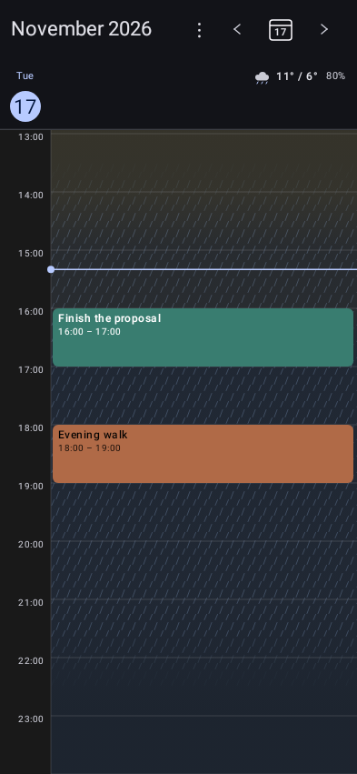
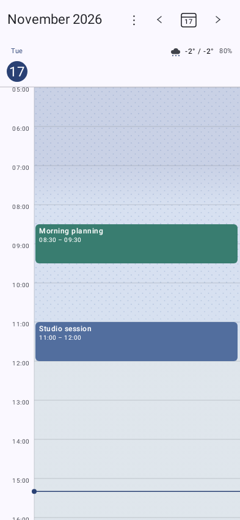

# Daylight

**An open-source Android calendar with a familiar day view, and the weather painted underneath it.**

*Daylight is a working name. The repository is `calendar`.*

## Why

On a phone, the calendar question is usually "what does today look like?". The day view answers half
of it: when you're busy. The other half lives in a weather app: is it dark by the time I leave, will the
6pm walk be in the rain, do I need a coat for the morning?

Daylight answers both on one screen. The day view works the way you already expect from mainstream
calendar apps. Behind it, the hours quietly carry the weather.

## What it does

- **A day view that feels familiar.**
  - Swipe left and right between days, and pinch to zoom the hours.
  - Rounded colour blocks, side by side when events overlap, plus an all-day row and the current-time line.
- **The feel of each hour, in the background.**
  - **Light:** warm when it's bright, flat grey when overcast, deep blue after dark.
  - **Cold:** an icy cast when it's cold, a warm one when it's warm.
  - **Rain:** fine streaks while it rains, denser when it rains harder.
- **The day at a glance:** a weather icon and the high and low next to the date, plus the chance of rain on wet days.
- **Your calendars, no new account.** Daylight reads the calendars your phone already syncs (Google,
  Exchange, CalDAV) through Android's calendar store. It never asks for your Google password, and its
  own servers don't exist.

Events always win: weather is painted under the grid, and nothing ever covers an event.

## Status

The phase 1 day view is implemented and tested on the JVM. Real-phone acceptance and polish are still
pending. See [docs/SPEC.md](docs/SPEC.md) for the full spec and phases.

| Phase | Scope | State |
|---|---|---|
| 1 | Day view with weather (read-only) | Implemented: events, paging, zoom, weather, offline fallback. Device verification pending. See [docs/TASKS.md](docs/TASKS.md) |
| 2 | Event details, create, edit, drag to reschedule | Planned |
| 3 | Week view | Planned |

## Build

Requires JDK 21 and the Android SDK (platform 37.0). [`scripts/setup-android-sdk.sh`](scripts/setup-android-sdk.sh)
installs the SDK on macOS or Linux.

```sh
scripts/setup-android-sdk.sh  # first run, unless ANDROID_HOME already points to an SDK
./gradlew test                 # unit + screenshot tests (no device needed)
./gradlew :app:assembleDebug   # build app/build/outputs/apk/debug/app-debug.apk
./gradlew :app:installDebug    # install on a connected phone (adb)
```

The app requests read-only calendar access on first launch. It displays calendars already synced to
Android and opens events in the installed calendar app. Weather uses your time-zone city unless you
choose **Weather options → Use approximate location**. Forecasts outside the available range, missing
locations, and network failures leave a normal calendar grid. **Weather options** also contains refresh
and Open-Meteo attribution.

Swipe between days, scroll the hours, and pinch vertically to zoom. The date-number button returns to
today. Event editing and week view belong to later phases.

To update screenshot baselines after an intentional UI change, run `./gradlew recordRoborazziDebug` and inspect the images
in `app/src/test/screenshots/` before committing them. Normal test runs verify those baselines.

CI runs the tests and builds the APK on every PR, then uploads a `daylight-debug` artifact containing
`app-debug.apk`. The screenshots use synthetic events, never private calendar data.

| Rainy evening, dark | Snowy morning, light |
|---|---|
|  |  |

See [docs/ARCHITECTURE.md](docs/ARCHITECTURE.md) for how it's put together.

## Privacy

Your calendar never leaves the phone. The only network request is the hourly forecast for your
approximate location, sent to [Open-Meteo](https://open-meteo.com/).

---

*An independent project. Not affiliated with Google or any calendar vendor. Weather data by
[Open-Meteo](https://open-meteo.com/) (CC BY 4.0). MIT licensed.*
